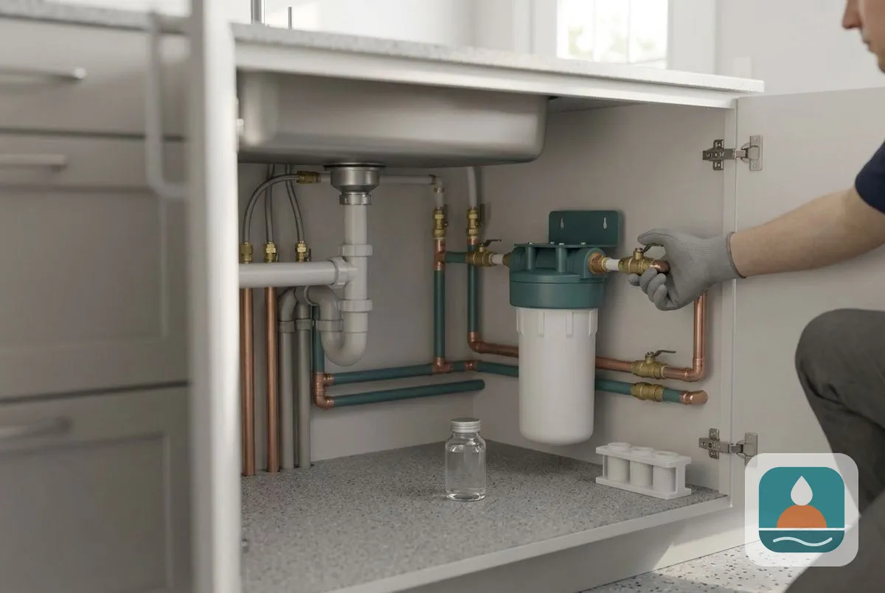
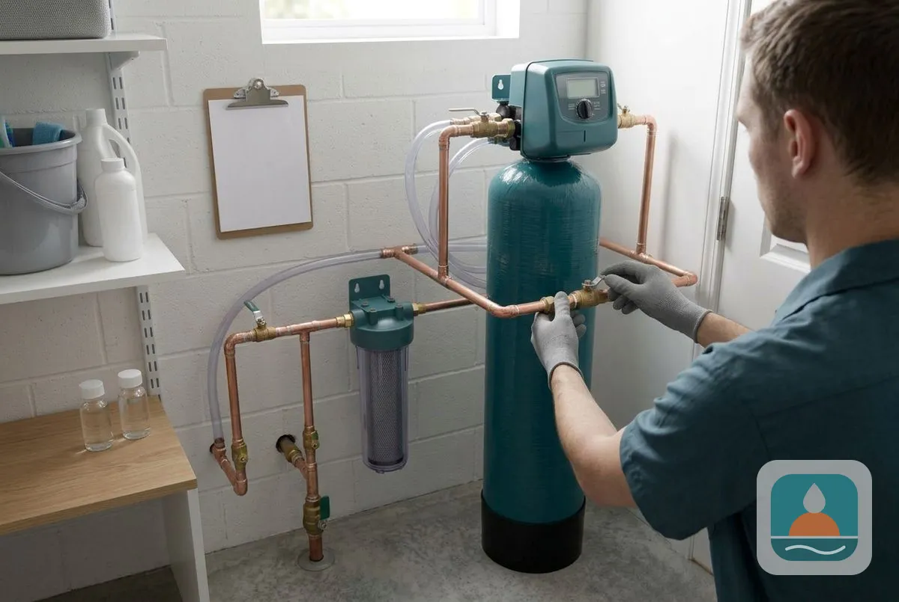
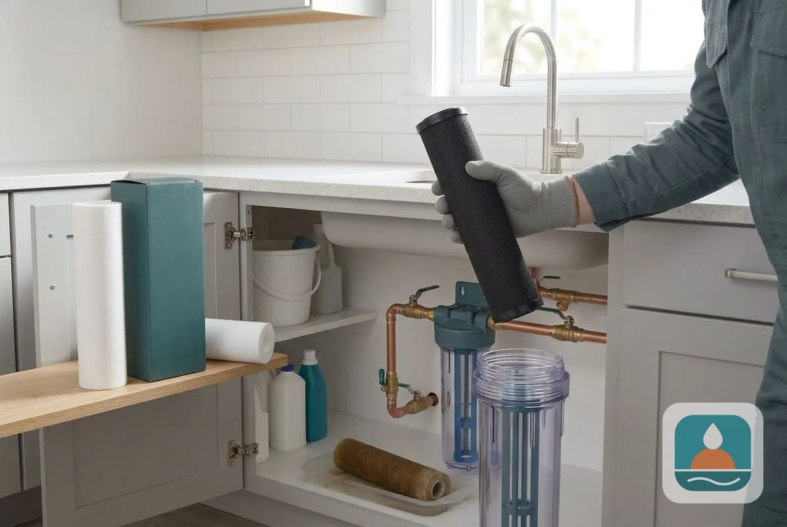
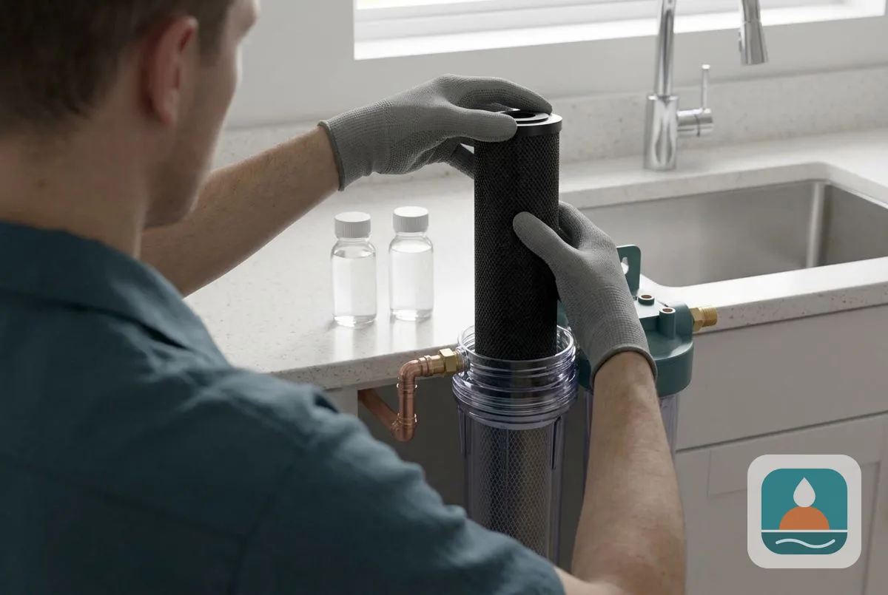
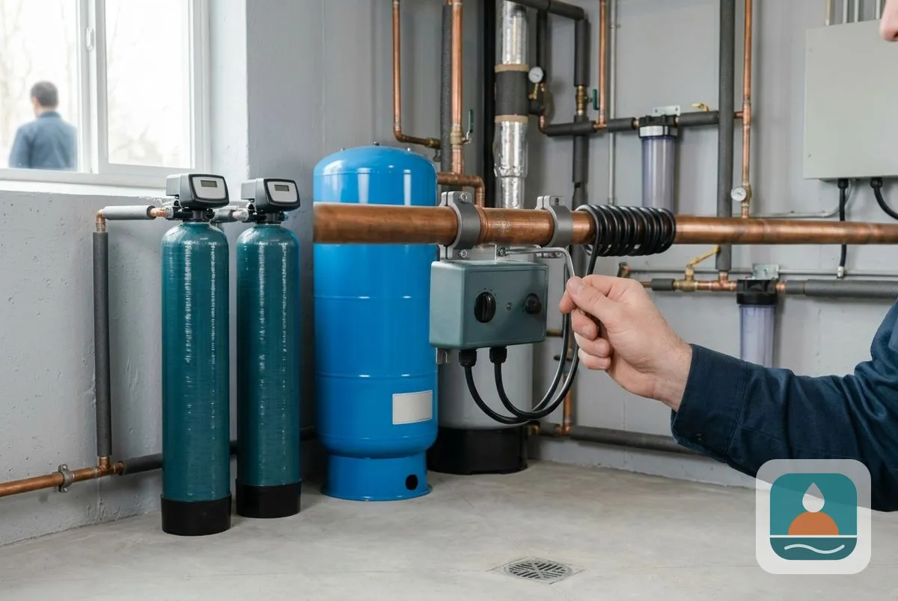
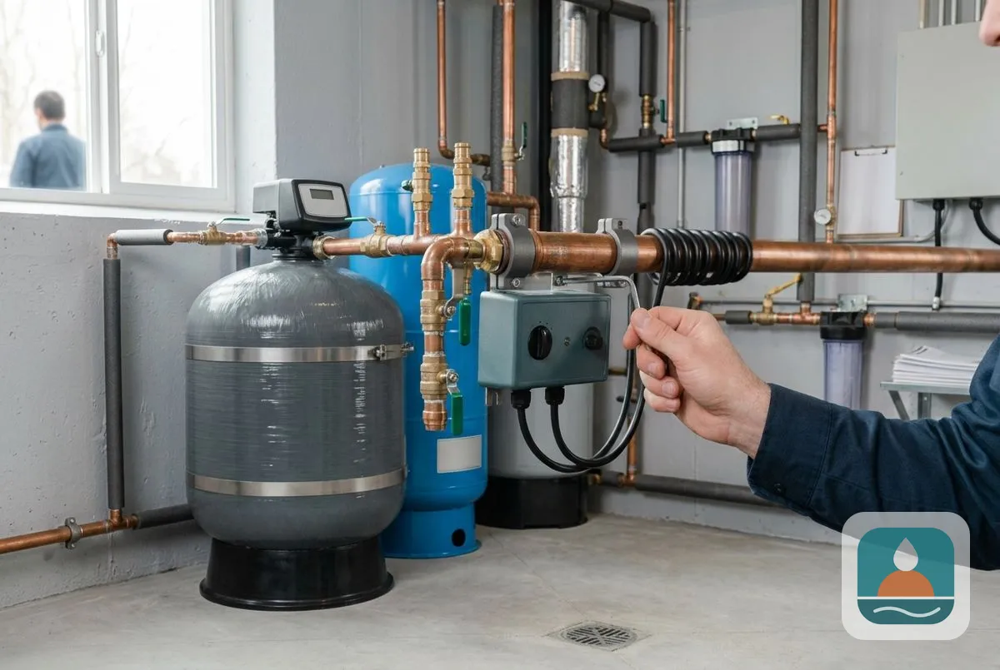

## Which Contaminants Can a Filter Remove in Lubbock, TX?

Six filter types target specific contaminants: lead and arsenic, chloramine and chlorine, fluoride, PFAS, nitrate and volatile organic compounds.

### Lead and Arsenic Removal

Lead enters drinking water mainly from old plumbing, and the EPA sets its health goal for lead at zero. Arsenic occurs naturally in some groundwater, and the EPA limit is 10 micrograms per liter. Under-sink [reverse osmosis systems](/reverse-osmosis-installation/) and certified filters reduce both. We recommend filters certified to the relevant NSF/ANSI standard and a test before and after installation.

### Chloramine and Chlorine Removal

Chlorine and chloramine are disinfectants that can affect taste and smell. Standard carbon removes chlorine well but works slowly on chloramine, so catalytic carbon is used for chloramine. Lubbock's water is disinfected with chlorine or chloramine at roughly 1.0 to 2.0 mg/L, so catalytic carbon is the safer choice for taste and smell.

### Fluoride Filter Installation

Fluoride occurs naturally in some groundwater, and the EPA enforceable limit is 4.0 milligrams per liter. Reverse osmosis and activated alumina media reduce fluoride. We install the type that suits your flow and budget.

### PFAS Water Filter

PFAS are man-made chemicals. In 2024 the EPA set limits of 4 parts per trillion for PFOA and PFOS in public water systems. Activated carbon, ion exchange and reverse osmosis can reduce PFAS, and results depend on the product. [Verify current EPA limits before launch]

### Nitrate Filter Installation

Nitrate comes from fertilizer, septic systems and livestock, and the EPA limit is 10 milligrams per liter as nitrogen. It matters most for infants and for [private wells](/well-water-softener-lubbock-tx/) in farming areas. Ion exchange and reverse osmosis reduce nitrate, and boiling water does not.

### VOC (Volatile Organic Compound) Filter

Volatile organic compounds are chemicals from fuels, solvents and industrial sources. Activated carbon is the standard treatment. A lab test confirms whether VOCs are present before you spend on a filter.

## When to Test for Contaminants

Test your water if you have a private well, an infant in the home, old plumbing, a change in taste or smell or a nearby source such as farming, fuel storage or industry. City of Lubbock water quality reports describe water that leaves the system, and roughly 60 to 70 percent of the city's supply comes from the Ogallala Aquifer. A test at your tap shows what reaches you. Ask which tests are free and which need an accredited lab, and what each costs.

> **Not a good fit if...** you have no test result. We do not sell a filter for a problem you may not have.

## How do you know which contaminant matters?

Only a test tells you. Start with a standard panel, then add tests for the concern that prompted it.

Homeowners comparing options also read about [free water testing](/water-quality-testing/), [whole-house water filtration](/water-filtration-systems/), [UV water purification](/uv-water-purification/) and [the hard water guide](/water-softener-guides/hard-water-lubbock-tx/).

## Frequently Asked Questions

Does one filter remove every contaminant?

No. Each contaminant needs its own method, and reverse osmosis covers the most. A test tells us which ones you need.

Is Lubbock tap water safe?

City reports list results against EPA limits. For your own tap, a home test checks what the report cannot, such as your plumbing.

How do I know a filter really works?

Look for certification to NSF/ANSI standards for the specific contaminant, and retest your water after installation.

Can a water softener remove these contaminants?

No. A softener removes hardness. Contaminant removal needs a different filter.

What does contaminant removal cost?

Whole-house carbon filtration and UV add-ons typically run $1,200 to $2,500 installed, and an under-sink reverse osmosis system for drinking water runs $550 to $1,200. It depends on the contaminant. The estimate is free and itemized.

[Lubbock Noble Water Softener TX](/) provides water contaminant removal for homes and businesses across Lubbock and Lubbock County.

## Get Your Free Estimate

Request a free water contaminant removal estimate. We will contact you within 24 hours. [Get a Free Estimate](#estimate) or return to Lubbock Noble Water Softener for every service we offer.
