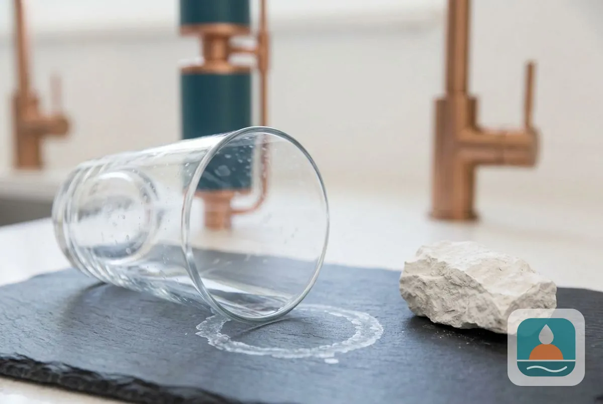
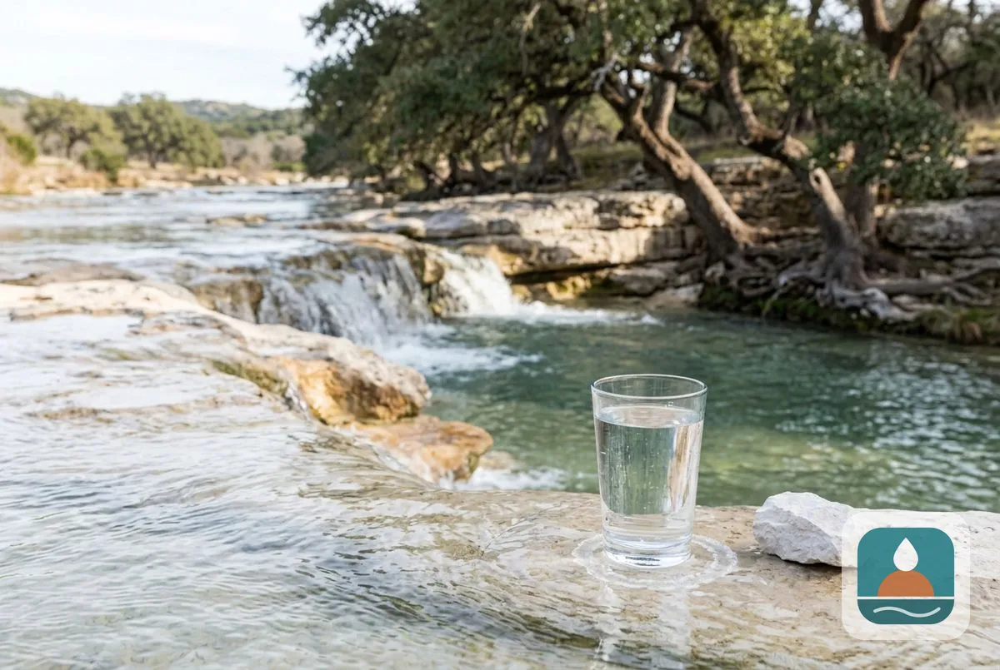
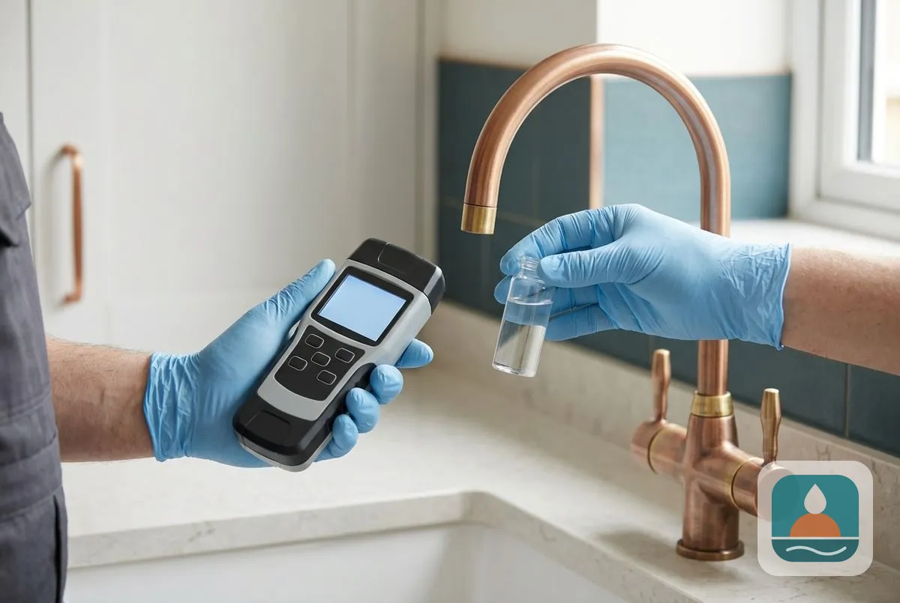

## What Do Lubbock Homeowners Need to Know About Hard Water?

Three questions cover the basics: what hard water is, why Lubbock water is hard and how hard it measures.

### What Is Hard Water?

Hard water is water with a high concentration of dissolved calcium and magnesium. These minerals dissolve as water moves through rock and soil, and they stay in the water until something removes them. Hardness is measured in milligrams per liter (mg/L) of calcium carbonate or in grains per gallon (gpg), where 1 gpg equals about 17.1 mg/L. The U.S. Geological Survey rates water under 60 mg/L as soft, 61 to 120 as moderately hard, 121 to 180 as hard and over 180 as very hard.

### Why Is Lubbock Water Hard?

Lubbock water is hard because most of it comes from underground. According to the City of Lubbock's 2025 water quality report, groundwater supplies 61 percent of the city's water, drawn from the Ogallala Aquifer through the Roberts County and Bailey County well fields. Lake Alan Henry and Lake Meredith supply the other 39 percent. Water that has traveled through the mineral-rich sediments of the High Plains picks up calcium and magnesium on the way.

### How Hard Is Lubbock Water?

City of Lubbock Water Utilities reports average hardness at approximately 205 mg/L, or 12 grains per gallon, which the U.S. Geological Survey rates as very hard. Readings vary across the city and through the year because the mix of well and lake water changes, so the number at your tap can differ. A free test at your address gives the figure that matters for choosing equipment.

### What Hard Water Does to a Home

- **Appliances:** Scale builds inside water heaters, dishwashers and washing machines. A heater coated in scale works harder to heat the same water.
- **Pipes and fixtures:** Mineral deposits narrow pipes, clog showerheads and leave white crust on faucets.
- **Skin and hair:** Hard water reacts with soap to form a film that leaves skin dry and hair dull.
- **Laundry:** Minerals stiffen fabric, dull colors and reduce how well detergent cleans.
- **Dishes and glass:** Spots and cloudy film appear after the dishwasher runs.

Hard water is a quality and comfort problem. The City of Lubbock's reports list results for regulated contaminants separately, and hardness is not a health-based limit.

### Solutions for Hard Water

Three options reduce the effects of hard water:

1. **A water softener** removes calcium and magnesium through ion exchange and gives true soft water. [Water softener installation](/water-softener-installation/) is the most complete fix for the whole house.
2. **A conditioner or descaler** changes how minerals form scale without removing them. It reduces scale with less maintenance but does not make water feel soft.
3. **Point-of-use treatment**, such as a shower filter or an under-sink system, improves one tap and leaves the rest of the house untreated.

Most Lubbock homeowners choose a [salt-based](/water-softener-guides/salt-vs-salt-free-water-softener/) softener when hardness is the main complaint. A test first confirms hardness and checks for iron, which affects [sizing](/water-softener-guides/water-softener-size-guide/).

## How do you know how hard your water is?

Test it. A home test strip gives a rough reading, and a technician test gives a precise one with iron and other values. Our [water quality testing](/water-quality-testing/) covers hardness, total dissolved solids, iron, pH and more.

To go further, see [salt-free water softener systems](/salt-free-water-softener-systems/) and [what a water softener costs](/water-softener-guides/water-softener-cost-lubbock-tx/).

## Frequently Asked Questions

Is Lubbock water safe to drink?

City of Lubbock water quality reports list results against federal limits. Hardness is a quality issue, not a health limit, and the reports cover regulated contaminants separately.

Does a water softener remove minerals I need?

A softener swaps calcium and magnesium for sodium or potassium. Food supplies most of your minerals, and drinking water is a minor source.

Why does my glassware spot even with a rinse aid?

Dissolved minerals dry on glass as white spots. Softened water stops the spotting at the source.

Can hard water damage my water heater?

Scale insulates the heating element or tank bottom, which makes the heater work harder and shortens its life. Flushing helps, and softened water prevents most of the buildup.

Do homes on well water have harder water?

Often yes, since private wells draw directly from the aquifer. A test shows the hardness and checks for iron and other minerals.

[Lubbock Elite Water Softener TX](/) provides water softener installation for homes and businesses across Lubbock and Lubbock County.

## Get Your Free Estimate

Request a free water test and softener estimate for your Lubbock home. We will contact you within 24 hours. [Get a Free Estimate](#estimate) or return to Lubbock Elite Water Softener for every service we offer.
