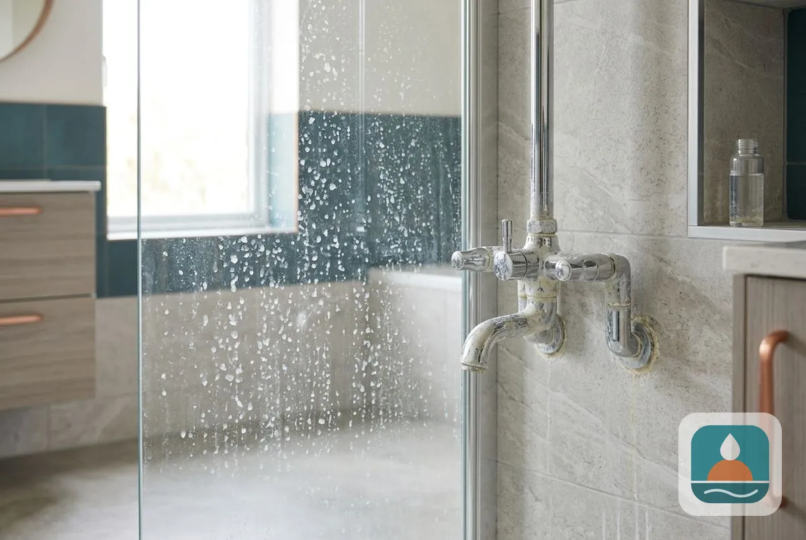
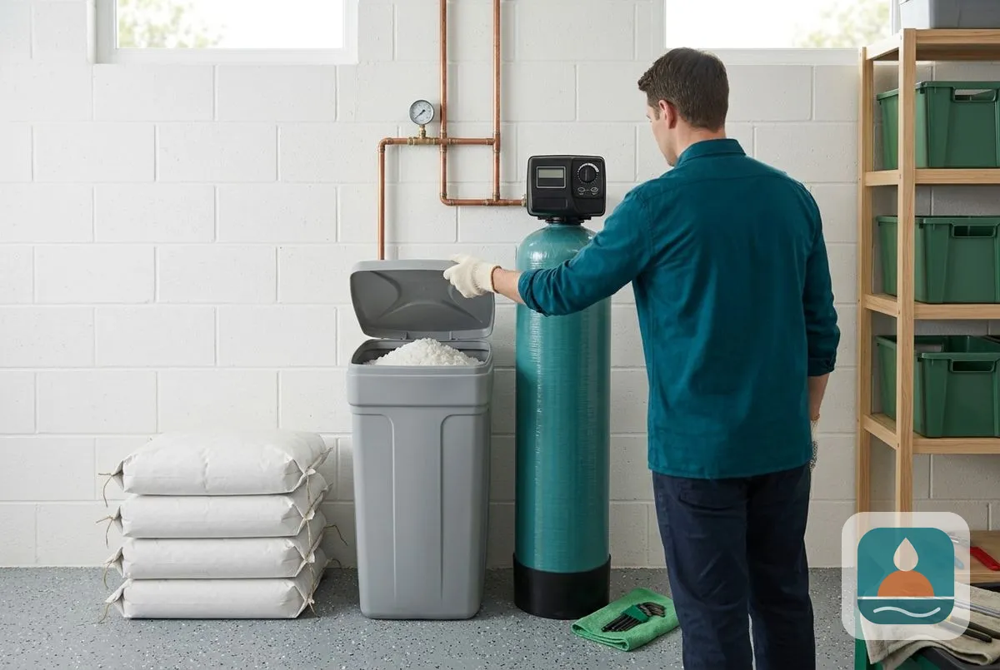
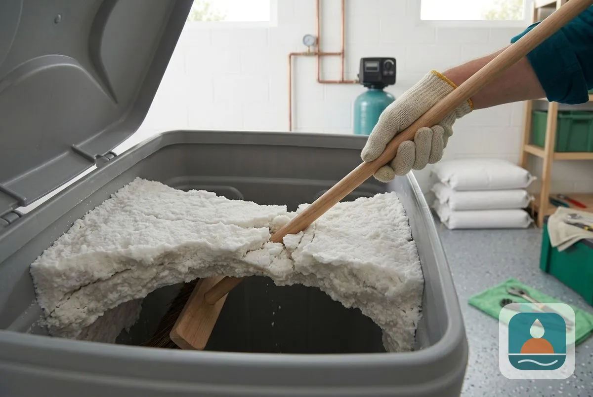
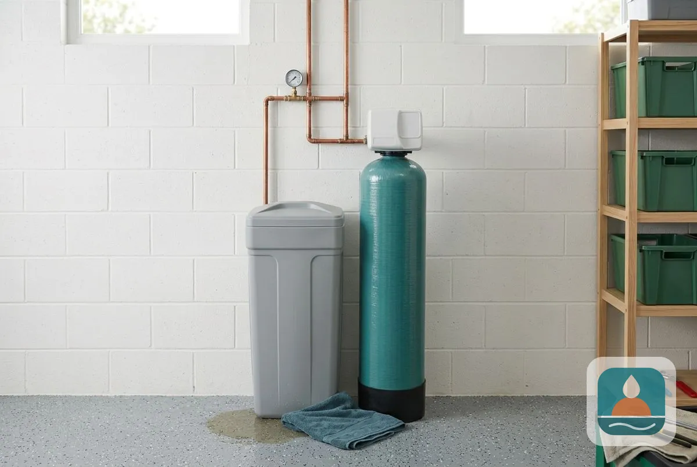
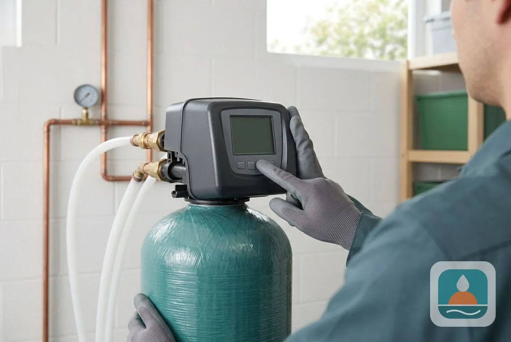
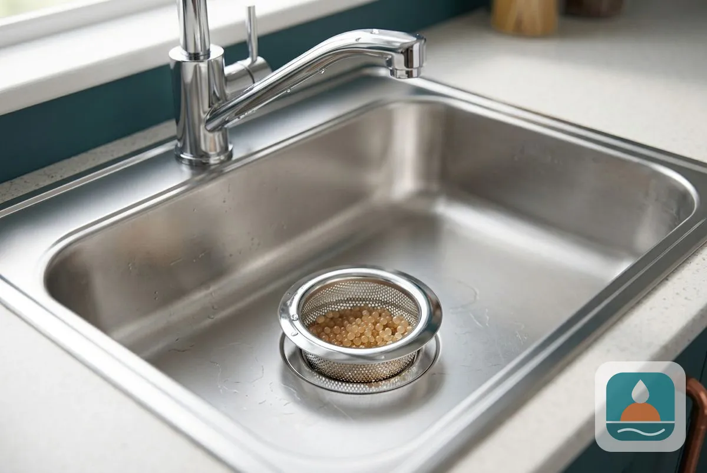

## What Are the Signs That a Lubbock Water Softener Needs Replacing?

Seven signs show a softener is failing, and the first six are listed below.

### 1. Hard-Water Symptoms Return

Spotted dishes, scale on faucets, soap film and stiff laundry come back even though the tank has salt. **Check:** run a [hardness test](/water-quality-testing/) on softened water. **Verdict:** if a clean valve and injector do not fix it, the resin is likely spent and needs replacing. City of Lubbock Water Utilities reports average hardness at approximately 205 mg/L, so the symptoms are obvious when softening fails.

### 2. Salt Use Rises Sharply

The unit goes through salt much faster than it used to. **Check:** compare how often you refill against last year. **Verdict:** a worn control head or fouled resin forces extra regenerations. A new control head or a new unit with demand-based regeneration cuts the waste.

### 3. Salt Bridges or Mush Keep Returning

A salt bridge is a hard crust above the water in the brine tank, and mush is a sludge at the bottom. **Check:** push a broom handle into the salt. **Verdict:** one-time cleaning fixes an isolated case. If it recurs after cleaning, the tank, float or salt type is the problem, and an older unit is better replaced.

### 4. Leaks From the Tank, Head or Drain

Water pools around the softener or drips from the control head. **Check:** find where the water starts. **Verdict:** a loose fitting or worn seal is a repair. A leaking or cracked resin tank means replacement.

### 5. Error Codes or No Cycling

The display shows repeated codes or the unit never starts a regeneration. **Check:** power, settings and the error code in your manual. **Verdict:** a motor, board or valve fault on a young unit is repairable. On an older unit, repeated faults point to replacement. Our [water softener repair](/water-softener-repair/) page covers what we fix.

### 6. Resin Beads in Faucets or Sinks

Tiny tan or yellow beads appear in faucet screens or the sink. **Check:** compare them to resin beads from your tank. **Verdict:** a broken distributor or worn tank lets resin escape. This usually calls for replacing the tank or the whole unit.

### 7. The Unit Is Past 10 to 15 Years Old

Industry guidance commonly cites [10 to 15 years](/water-softener-guides/how-long-do-water-softeners-last/) for a residential softener. **Check:** find the date on the tank label. **Verdict:** at or beyond that age, with any of the signs above, replacement usually costs less over time than repeated repairs.

> **Not a good fit if...** your unit is under about five years old and only shows one sign. Repair or maintenance is the cheaper answer. See our [water softener replacement](/water-softener-replacement/) page for when a new unit makes sense.

## Should you repair or replace?

Repair a young unit with one failed part. Replace an old unit, a leaking tank or one that keeps failing. A free inspection compares both prices side by side.

To go further, see [what a water softener costs](/water-softener-guides/water-softener-cost-lubbock-tx/) and [water softener maintenance](/water-softener-maintenance/).

## Frequently Asked Questions

How can I tell if my softener is working?

Test the softened water for hardness or watch for spots and scale. Soft water also makes soap lather easily.

Is a new softener worth it if mine is 12 years old?

Often yes, if it shows any of the signs above. New units regenerate by demand and use less salt and water.

Can I replace just the control head?

Yes, when the tank and resin are sound. It restores timing and cycles for less than a new unit.

How long does replacement take?

Most replacements finish in one visit, often in 2 to 4 hours.

[Lubbock Noble Water Softener TX](/) provides water softener replacement for homes and businesses across Lubbock and Lubbock County.

## Get Your Free Estimate

Request a free softener inspection and replacement estimate for your Lubbock home. We will contact you within 24 hours. [Get a Free Estimate](#estimate) or return to Lubbock Noble Water Softener for every service we offer.
