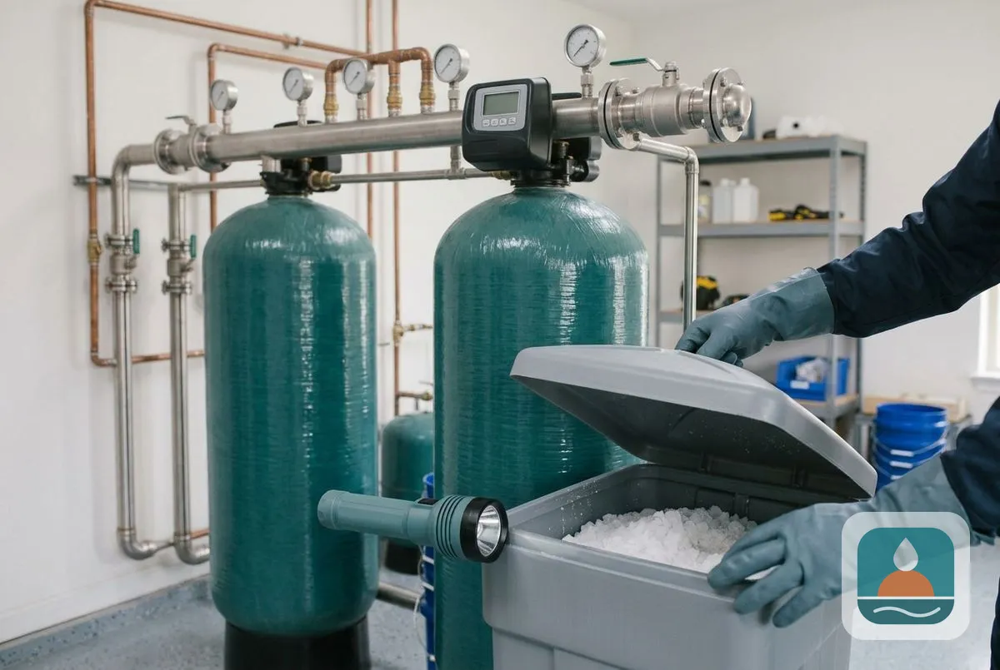
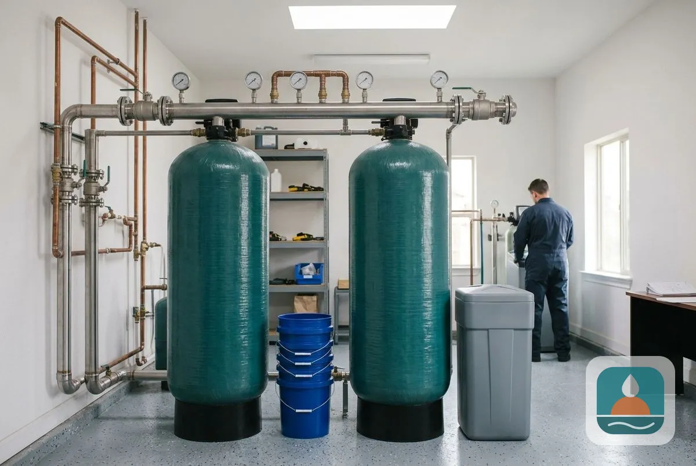
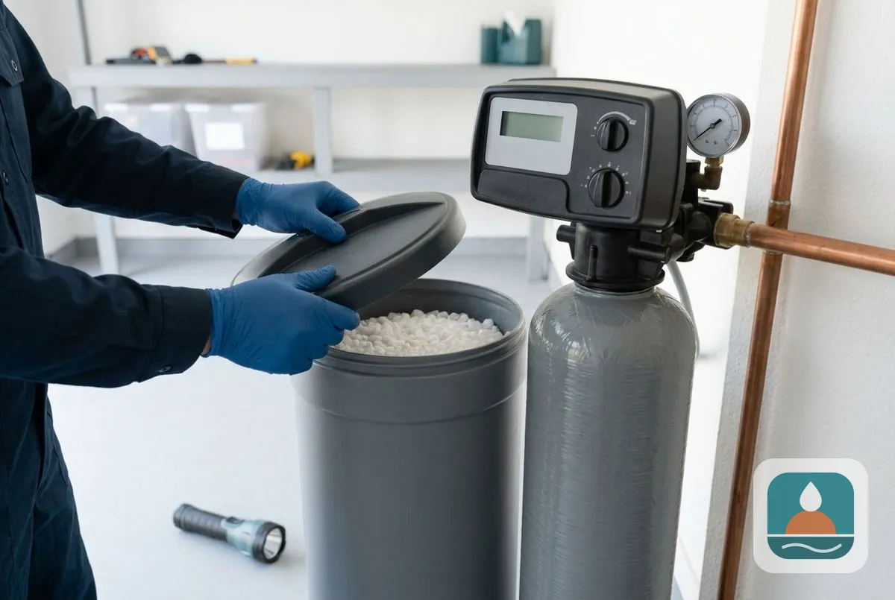
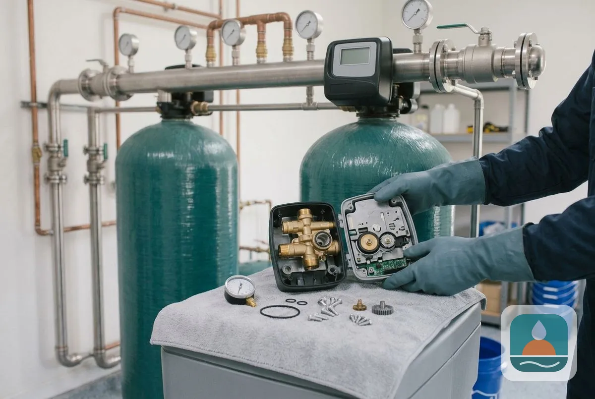

### Why Lubbock Water Needs a Water Softener System

Lubbock water is hard because most of it starts underground. City of Lubbock water quality reports show that roughly 60 to 70 percent of the supply is groundwater from the Ogallala Aquifer, pumped from the Roberts County and Bailey County well fields. The rest is surface water from Lake Alan Henry and Lake Meredith. Groundwater carries dissolved calcium and magnesium, and those minerals form scale in water heaters, pipes and fixtures. City of Lubbock Water Utilities reports average hardness at approximately 205 mg/L, or 12 grains per gallon, which the U.S. Geological Survey rates as very hard.

A softening system treats the water where it enters the home, so every tap benefits. For the full picture of what hard water does and how we handle it, see Lubbock Noble Water Softener.

## What Types of Water Softener Systems Are Available in Lubbock, TX?

This page covers installation, replacement, salt-free systems, dual tank systems, commercial systems, maintenance, repair and water conditioners, starting with why Lubbock water needs a softener.

### Water Softener Installation

[Water softener installation](/water-softener-installation/) connects a whole-house unit to your main water line, with a bypass valve, a drain line and a tested result at every tap. It is the starting point for most Lubbock homeowners.

### Water Softener Replacement

[Water softener replacement](/water-softener-replacement/) removes a failing or undersized unit and installs a correctly sized new one, including resin bed and upgrade options.

### Salt-Free Water Softener Systems

[Salt-free water softener systems](/salt-free-water-softener-systems/) condition the water so scale does not stick. They need no salt and no drain line, and they leave the minerals in the water, so they reduce scale rather than remove hardness.

### Dual Tank Water Softener Installation

A [dual tank water softener](/dual-tank-water-softener/) uses two tanks, so one serves the house while the other regenerates. Soft water never pauses, which suits large households and heavy water use.

### Commercial Water Softener Installation

A [commercial water softener](/commercial-water-softener/) protects boilers, dishwashers, ice machines and plumbing in businesses where hard water raises maintenance costs.

### Water Softener Maintenance

[Water softener maintenance](/water-softener-maintenance/) covers salt refills, resin cleaning and brine tank cleaning that keep a system softening at full capacity.

### Water Softener Repair

[Water softener repair](/water-softener-repair/) fixes valves, motors, floats, injectors, heads and leaks, and diagnoses units that stop regenerating or show error codes.

## How do you choose between a softener, a conditioner and filtration?

A softener removes hardness minerals. A conditioner changes how scale behaves without removing the minerals. A filter removes particles, taste and odor but does not soften water. Many Lubbock homes need a softener plus a filter, and a free water test shows which combination fits your tap water. Our [water treatment services](/water-treatment-and-testing/) cover conditioners, filtration, purification and testing.

## Frequently Asked Questions

What is the difference between a salt-based and a salt-free water softener?

A salt-based softener removes calcium and magnesium through ion exchange and needs salt refills. A salt-free system conditions the water so scale does not stick, adds no sodium and needs no drain. Salt-based units soften water, and salt-free units reduce scale.

Which water softener system is best for a large Lubbock household?

A dual-tank or higher-capacity single-tank system suits large households, because it keeps up with high daily water use. The technician sizes the system from your household size and a hardness reading.

Do homes on well water need a different system?

Often yes. Well water can carry iron, sulfur or sediment that need filtration before a softener, and a test shows which. Our well water page covers the options.

Can one company install, maintain and repair my system?

Yes. Lubbock Noble Water Softener installs, replaces, maintains and repairs softeners, so one call covers the life of the system.

[Lubbock Noble Water Softener TX](/) provides water softener systems for homes and businesses across Lubbock and Lubbock County.

## Get Your Free Estimate

Not sure which system fits? Request a free estimate and we will contact you within 24 hours. [Get a Free Estimate](#estimate) or return to the Lubbock water softener company homepage.
